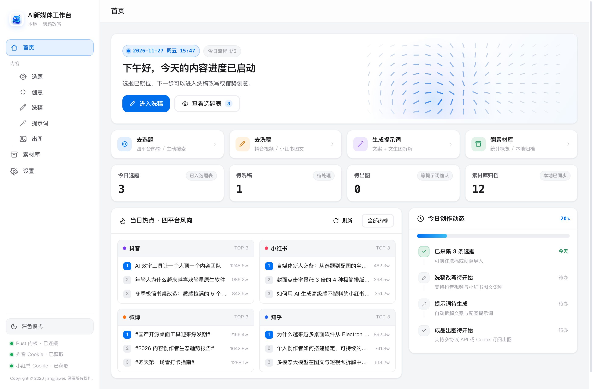
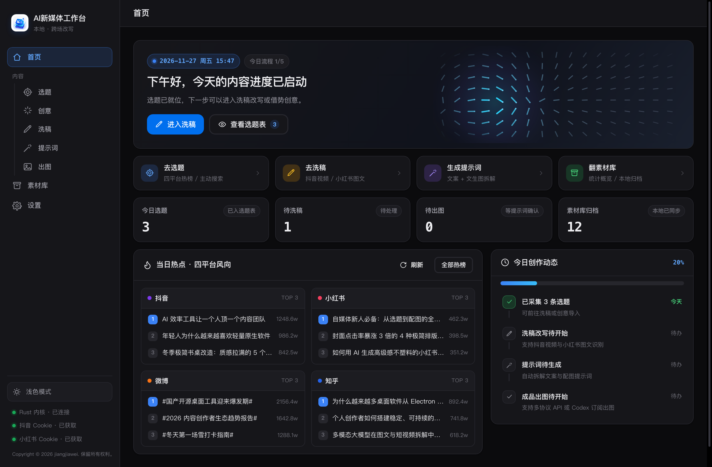
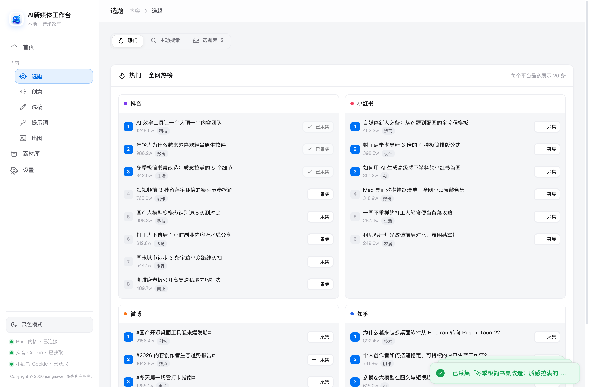
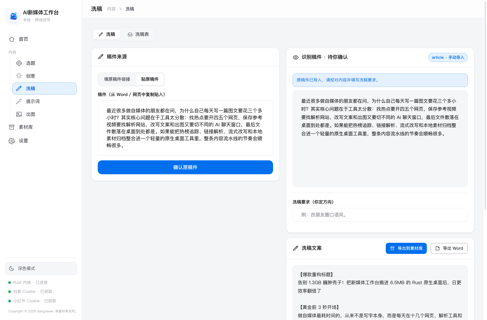
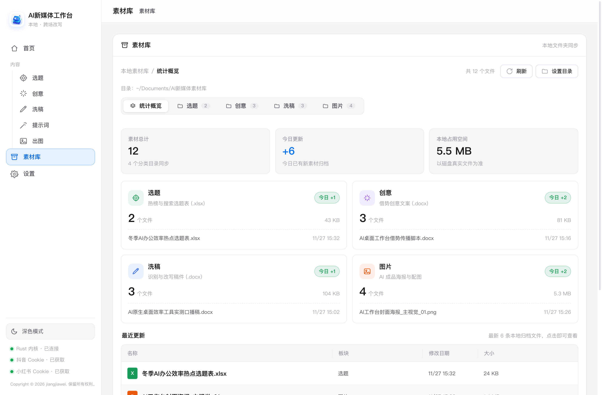
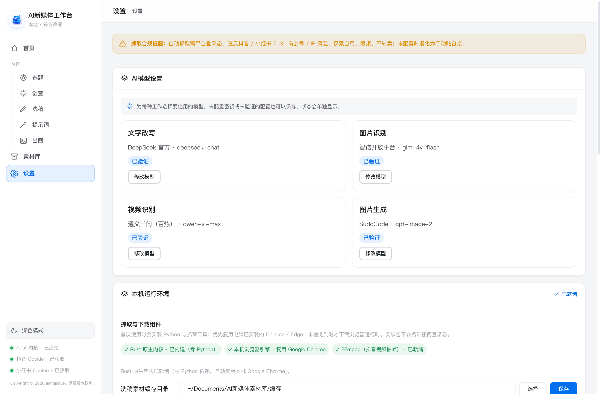

<div align="center">


<h1>AI新媒体工作台</h1>

<p><strong>轻量级跨平台新媒体内容生产原生桌面工作台（Rust + Tauri 2）</strong></p>

<p>覆盖 <strong>热点选题 → 借势创意 → 爆款洗稿 → 提示词工程 → 多协议 AI 出图 → 本地素材库</strong> 全链路内容流水线</p>

<p>
  <a href="https://github.com/weiweidounai0131/AI-newmedia-workbench/releases/latest">
    
  </a>
  
  
  
  
  
</p>

<p>
  <a href="#-界面预览">🖼️ 界面预览</a> •
  <a href="#-核心功能一览">✨ 核心功能</a> •
  <a href="#-v20-原生架构进化">⚡ 架构对比</a> •
  <a href="#-下载与安装">⬇️ 下载安装</a> •
  <a href="#-本地开发与构建">🛠️ 本地开发</a> •
  <a href="#-上游项目与开源致谢">🙏 上游致谢</a>
</p>

<br />

<!-- 根据 GitHub 当前深/浅主题自动切换首屏展示图 -->
<picture>
  <source media="(prefers-color-scheme: dark)" srcset="./docs/screenshots/02-home-dark.png" />
  <source media="(prefers-color-scheme: light)" srcset="./docs/screenshots/01-home-light.png" />
  
</picture>

</div>

---

## ✨ 项目简介

**AI新媒体工作台** 面向个人自媒体创作者与内容运营团队，将日常最耗时的分散操作——刷四平台热榜、主动搜索对标内容、提取无水印视频/图文、拆解口播结构、流式洗稿改写、拆分生图提示词、AI 出图与本地文件归档——整合进一个极简、冷启动毫秒级的跨平台原生桌面应用。

自 **v2.0** 起，项目全面升级为 **Rust + Tauri 2 原生桌面架构**，彻底移除 Electron、Express、Python 虚拟环境、Playwright 与外部第三方依赖窗口：

- **极致轻量化**：macOS Apple Silicon 安装包仅 **6.5 MB**，Windows x64 安装包仅 **4.4 MB**（较 v1.x 瘦身 **99%+**）。
- **零外部运行时**：无需安装 Python 或 Playwright，自动静默复用本机 Chrome / Edge 浏览器内核。
- **全协议多模型自由切换**：文字、视觉识别、生图四大能力槽位独立配置，全面支持 `OpenAI Chat Completions`、`OpenAI Responses`、`Anthropic Messages` 与 `Google Gemini` 协议，并支持自动发现本机 `Codex CLI` 登录态。
- **隐私与密钥本地掌控**：所有素材落盘在你指定的本地目录，API 密钥经本地 `0600` 权限 `scrypt + AES-256-GCM`（macOS）/ 系统凭据管理器（Windows）加密保存，明文永不进入前端。

> 原 v0.1.x Electron 版本完整源码仍保留归档于 [`v1-electron`](https://github.com/weiweidounai0131/AI-newmedia-workbench/tree/v1-electron) 分支。

---

## 🖼️ 界面预览

<table>
  <tr>
    <td width="50%" align="center">
      
      <br />
      <sub><strong>首页 · 4 层 Bento 仪表盘（浅色模式）</strong><br />磁感微指针待机动效 · 快捷入口 · 今日 KPI · 四平台风向 · 创作动态</sub>
    </td>
    <td width="50%" align="center">
      
      <br />
      <sub><strong>首页 · 自适应暗黑模式</strong><br />深色通透层级与磁感微指针高光交互，长时间夜间创作更舒适</sub>
    </td>
  </tr>
  <tr>
    <td width="50%" align="center">
      
      <br />
      <sub><strong>选题中心 · 四平台实时热榜与主动搜索</strong><br />抖音 / 小红书 / 微博 / 知乎整点缓存、双源容灾、一键采集与 Excel 导出</sub>
    </td>
    <td width="50%" align="center">
      
      <br />
      <sub><strong>洗稿工作台 · 无水印链接解析与 SSE 流式改写</strong><br />支持抖音视频抽帧识别、小红书图文解析与原稿直贴，一键导出 Word</sub>
    </td>
  </tr>
  <tr>
    <td width="50%" align="center">
      
      <br />
      <sub><strong>本地素材库 · 实时磁盘同步与统计概览</strong><br />四大板块分类统计、今日增量追踪、原生预览与访达/资源管理器直达</sub>
    </td>
    <td width="50%" align="center">
      
      <br />
      <sub><strong>设置中心 · 四能力多协议模型与环境自检</strong><br />内置 DeepSeek / 智谱 / 通义千问 / SudoCode，支持自定义中转与三源热更新</sub>
    </td>
  </tr>
</table>

---

## ⚡ v2.0 原生架构进化

| 对比维度 | v1.x（`v1-electron` 归档） | v2.0.2（当前 Rust + Tauri 2 原生版） |
| :--- | :--- | :--- |
| **安装包体积** | ~1.32 GB（386 MB 应用 + 876 MB Python 环境） | **macOS 6.5 MB / Windows 4.4 MB**（直降 99%+） |
| **外部运行时依赖** | 需捆绑 Python / Playwright / 第三方桌面工具 | **零 Python、零 Playwright**，自动静默复用本机 Chrome / Edge |
| **交互与 AI 响应** | 一次性等待整段返回 | **全站统一 SSE 真流式输出** + `motion/react` 弹簧物理动效 |
| **视频 / 图文解析** | 依赖外部工具子进程与 iframe 窗口 | **纯 Rust 原生四级解析下载器**（`a_bogus` + CDP）+ FFmpeg 关键帧提取 |
| **密钥与安全存储** | 明文或易触发系统重复弹窗 | **macOS `0600` 本地派生 `AES-256-GCM`（彻底告别更新弹钥匙串密码）** / Windows 凭据管理器 |
| **自动更新机制** | 单源下载更新 | **Ed25519 签名校验 + 国内优先三源容灾**（阿里云 OSS → Cloudflare R2 → GitHub Releases） |

---

## 🚀 核心功能一览

### 1. 首页工作台（4 层 Bento 仪表盘）
- **智能时段问候与引导**：自动感知今日创作流程进度（`0/5 ~ 5/5`），一键直达下一步待办环节。
- **磁感微指针矩阵（Magnetic Filings）**：纯 Canvas 高刷待机氛围动效，待机自主双极巡航、鼠标滑过弹簧磁吸，切后台或离屏自动挂起实现 **0% CPU 占用**。
- **当日热点与创作动态**：一屏联动展示四平台 TOP3 风向、快捷入口条、4 列核心 KPI 与垂直创作时间轴。

### 2. 选题中心（实时热榜 + 静默搜索 + 选题表）
- **四平台实时热榜**：覆盖 **抖音、小红书、微博、知乎**，支持整点内存缓存与 `60s` + `UAPIS` 双源自动故障切换。
- **后台静默主动搜索**：基于纯 Rust CDP 引擎，复用本机 Chrome / Edge（`--headless=new`）在隔离 Profile 中静默采集；遇到平台安全验证支持按需拉起验证窗口，内置冷却限频与合规风控提醒。
- **原生 Excel 选题表**：一键采集至选题表、外链直达默认浏览器，支持系统原生「另存为」导出标准 `.xlsx` 或归档至素材库。

### 3. 创意策划（热点借势 + 4 方向发散）
- 支持直接从选题表导入热点，结合业务切入点一键生成 **4 个差异化借势方向**。
- 选定方向后流式产出完整传播脚本文案，支持多轮追问优化与 Word 导出。

### 4. 洗稿工作台（抖音无水印视频 / 小红书图文 / 原稿直贴）
- **抖音解析**：纯 Rust 实现 `a_bogus`（RC4 + 国密 SM3）签名与四级解析兜底，高速下载无水印视频，自动调用本机 FFmpeg 抽取轻量化关键帧送入视觉大模型还原口播脚本与镜头结构。
- **小红书解析**：复用已登录 CDP 会话精准提取 `window.__INITIAL_STATE__`，并发下载无水印高清图片与 `文案.txt` 至统一缓存目录，逐图交由视觉模型理解。
- **流式改写与导出**：支持自定义改写人设与口吻，实时 SSE 流式产出，一键原生「另存为」`.docx` 或入库。

### 5. 提示词工程 & 多协议 AI 出图
- **三级容错图文拆解**：将长文案自动拆分为发布正文与多张分镜配图提示词，一键带入出图工作台。
- **全面放开生图协议**：支持原生 `/images/generations` & `/images/edits`（参考图重绘）、自动兜底 `/chat/completions` 对话式生图、`OpenAI Responses`、`Anthropic Messages` 及 `Google Gemini` 原生生图接口。
- **Codex CLI 无感集成**：自动检测本机已登录的 OpenAI Codex CLI 订阅状态，支持隔离式极速出图。

### 6. 本地素材库（实体文件同步 + 统计概览）
- **数据主权完全归你**：按 `选题 / 创意 / 洗稿 / 图片` 四大目录实时扫描你指定的本地文件夹，无云端锁定。
- **统计概览首页**：直观呈现素材总量、今日新增数、磁盘占用空间与近期产出记录，支持应用内图片预览及一键在访达 / 资源管理器中定位。

---

## 🧠 AI 能力与多协议支持矩阵

工作台将模型拆分为四个独立能力槽位，均支持自定义供应商、自定义 Base URL、自动拉取远端模型列表与独立连通性验证：

| 能力槽位 | 默认预置供应商（均默认未填 Key） | OpenAI Chat Completions | OpenAI Responses | Anthropic Messages | Google Gemini | 本机 Codex CLI |
| :--- | :--- | :---: | :---: | :---: | :---: | :---: |
| **文字改写** | DeepSeek / 智谱 / 通义千问 | ✅ | ✅ | ✅ | — | — |
| **图片识别** | 智谱 / 通义千问 / DeepSeek | ✅ | ✅ | ✅ | — | — |
| **视频识别** | 通义千问 / 智谱 / DeepSeek | ✅ | ✅ | ✅ | — | — |
| **图片生成** | SudoCode（支持任意兼容接口） | ✅（含对话生图兜底） | ✅ | ✅ | ✅ | ✅ |

> **智能网络代理分流**：抖音 / 小红书抓取与媒体下载强制国内直连；远端 AI 模型请求自动识别系统代理；本机回环网关（`127.0.0.1` / `localhost`）自动免代理直连。

---

## ⬇️ 下载与安装

前往 [**GitHub Releases**](https://github.com/weiweidounai0131/AI-newmedia-workbench/releases/latest) 获取最新双平台正式安装包（安装后即可通过内置三源自动更新通道一键热更新）：

| 平台 | 安装包文件 | 体积 | 说明 |
| :--- | :--- | :---: | :--- |
| **macOS (Apple Silicon)** | `AI-newmedia-workbench_2.0.2_aarch64.dmg` | ~6.5 MB | 镜像内附可视化首次安装指引 |
| **Windows (x64)** | `AI-newmedia-workbench_2.0.2_x64-setup.exe` | ~4.4 MB | NSIS 标准安装向导，支持自定义路径 |

### 安装注意事项
1. **macOS 首次打开提示「无法验证开发者」**：因个人开源项目未购买 Apple Developer 年费公证证书，请将应用拖入「应用程序」后，在终端执行一次：
   ```bash
   xattr -cr /Applications/AI新媒体工作台.app
   ```
2. **抖音视频识别可选依赖**：如需在「洗稿」模块自动解析抖音视频画面，建议本机安装 [FFmpeg](https://ffmpeg.org/)（macOS 可执行 `brew install ffmpeg`，应用内也会在未检测到时提供引导）。

---

## 🛠️ 本地开发与构建

### 前置环境
- **Node.js** `22+`
- **Rust** `stable`（2021 edition）
- 对应操作系统的 [Tauri 2 系统构建依赖](https://v2.tauri.app/start/prerequisites/)

### 常用命令

```bash
# 1. 克隆仓库
git clone https://github.com/weiweidounai0131/AI-newmedia-workbench.git
cd AI-newmedia-workbench

# 2. 安装前端依赖
npm install --legacy-peer-deps

# 3. TypeScript 类型检查 & 前端构建
npm run build

# 4. 运行 Rust 单元测试
cd src-tauri && cargo test && cd ..

# 5. 启动桌面端热重载开发模式
npm run tauri:dev

# 6. 构建当前平台正式安装包
npm run tauri:build
```

### 项目目录概览

```text
.
├── src/                        # React 18 + TypeScript + HeroUI 前端
│   ├── views/                  # Home / Xuanti / Chuangyi / Xigao / Tishici / Chutu / Sucai / Settings
│   ├── motion/                 # Motion 弹簧动效原语 & MagneticFilings 磁感微指针矩阵
│   ├── store/appStore.ts       # 跨视图轻量状态总线（useSyncExternalStore）
│   └── api/                    # Tauri IPC 调用封装与事件监听
├── src-tauri/src/              # Rust 原生后端内核
│   ├── core/                   # AI 多协议代理、加密密钥存储、热榜双源容灾、本地素材库、自动更新
│   ├── cdp/                    # 纯 Rust Chrome DevTools Protocol 静默搜索与登录态引擎
│   ├── downloader/             # 抖音（a_bogus 四级解析 + FFmpeg 抽帧）与小红书原生无水印下载器
│   └── commands/               # 暴露给前端的 Tauri Commands
└── docs/screenshots/           # README 软件实机界面配图
```

---

## 🙏 上游项目与开源致谢

本项目的诞生与从 v1.x 到 v2.0 的演进离不开以下优秀开源项目与公开服务的启发、支持与底座支撑，特此致谢：

### 数据源与采集解析参考

| 项目 / 服务 | 仓库 / 官网 | 在本项目中的作用与关联 |
| :--- | :--- | :--- |
| **60s API** | [`vikiboss/60s`](https://github.com/vikiboss/60s) | 提供抖音、小红书、微博、知乎四平台实时热榜主数据源（`60s.viki.moe`） |
| **UAPIS** | [`uapis.cn`](https://uapis.cn/) | 提供公开热榜 API，作为本工作台四平台热榜的自动容灾备用源 |
| **MediaCrawler** | [`NanmiCoder/MediaCrawler`](https://github.com/NanmiCoder/MediaCrawler) | `v1-electron` 分支曾集成其多平台采集代理；`v2.0` 参考其平台搜索路径与风控思路，以纯 Rust 原生 CDP 引擎重写实现 |
| **wechat-mp-tools** | [`x554960766/wechat-mp-tools`](https://github.com/x554960766/wechat-mp-tools) | `v1-electron` 分支曾集成其抖音/小红书解析下载能力；`v2.0` 参考其多级解析与本地归档流程，以纯 Rust 原生下载器重写替代 |
| **FFmpeg** | [`FFmpeg/FFmpeg`](https://github.com/FFmpeg/FFmpeg) | 承担抖音无水印视频的本地轻量化关键帧抽取，驱动视觉大模型进行口播与画面还原 |
| **OpenAI Codex CLI** | [`openai/codex`](https://github.com/openai/codex) | 支持自动发现本机 Codex CLI 登录态，为图片生成模块提供可选的隔离订阅生图通道 |

### 桌面框架、前端界面与动效

| 项目 | 仓库 / 官网 | 作用 |
| :--- | :--- | :--- |
| **Tauri 2** | [`tauri-apps/tauri`](https://github.com/tauri-apps/tauri) | 跨平台轻量桌面容器、原生系统对话框、URL 打开器及 Ed25519 签名自动更新框架 |
| **HeroUI** | [`heroui-inc/heroui`](https://github.com/heroui-inc/heroui) | 现代化 React 组件库与无障碍语义交互体系 |
| **Motion** | [`motiondivision/motion`](https://github.com/motiondivision/motion) | 物理弹簧动效引擎；首页顶部待机磁感微指针矩阵灵感源自 [Motion Magnetic Filings](https://motion.dev/examples/react-magnetic-filings) |
| **React / Vite / Tailwind CSS** | [`react`](https://github.com/facebook/react) · [`vite`](https://github.com/vitejs/vite) · [`tailwindcss`](https://github.com/tailwindlabs/tailwindcss) | 前端构建、响应式样式与渲染底座 |

### Rust 核心生态依赖

- [**Tokio**](https://github.com/tokio-rs/tokio) & [**tokio-tungstenite**](https://github.com/snapview/tokio-tungstenite) — 高并发异步运行时与原生 CDP WebSocket 通信
- [**reqwest**](https://github.com/seanmonstar/reqwest) — 基于 `rustls` 的异步 HTTP / SSE 流式客户端与智能代理路由
- [**RustCrypto (`aes-gcm` / `scrypt`)**](https://github.com/RustCrypto/AEADs) & [**keyring-rs**](https://github.com/open-source-credentials/keyring-rs) — 本地高强度密钥加密存储与系统凭据管理
- [**rust_xlsxwriter**](https://github.com/jmcnamara/rust_xlsxwriter) & [**zip-rs**](https://github.com/zip-rs/zip2) — 纯 Rust 原生 `.xlsx` 选题表导出与 OOXML `.docx` 文档读写

---

## ⚠️ 合规与免责声明

1. 本项目仅用于**个人学习、技术研究与内部内容创作效率提升**，严禁用于高频恶意采集、破坏平台正常运营或任何违反法律法规及第三方平台服务协议（ToS）的用途。
2. 平台登录态采集与链接解析功能内置冷却保护与风控提示，使用者需自行承担合规使用责任。
3. 本软件不包含、亦不内置任何官方 API Key 或平台账号数据，所有 AI 模型服务均由用户自行配置并直连对应服务商。

---

<div align="center">
  <sub>如果这个项目对你的内容创作有帮助，欢迎点一颗 ⭐ Star 支持！</sub>
</div>
