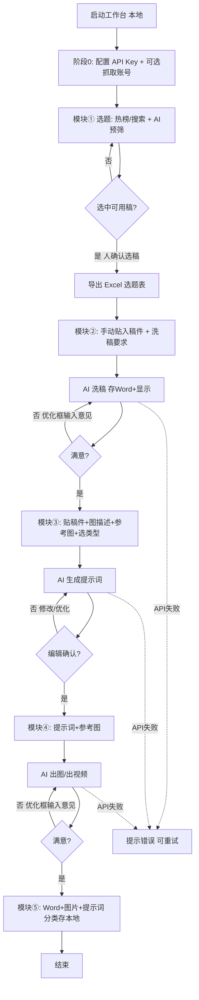
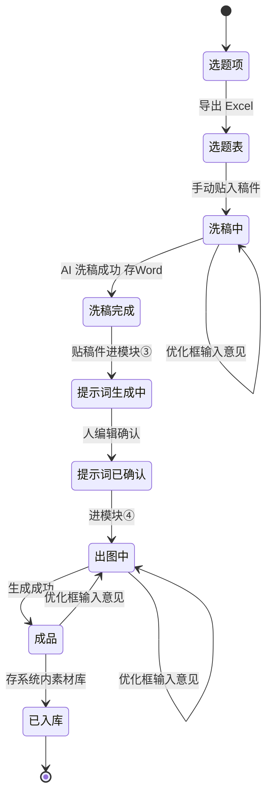

# 产品需求文档：新媒体工作台 - V1.1

## 1. 综述 (Overview)

### 1.1 项目背景与核心问题
用户是一名新媒体运营者，日常把**公域平台（抖音/小红书）的爆款内容**，转译成适合**自有分发场（朋友圈图文/海报）**的成品内容。该流程已用 AI（GPT）手工跑通：选题 → 洗稿 → 生成图片提示词 → 出图 → 沉淀库存。

核心问题：**流程依赖大量手动复制粘贴与多工具切换**，且提示词链（know-how）只存在个人脑中/聊天记录里，不可复用、不可沉淀。本项目本质是「**把已有的提示词链装上界面**」——不是重新发明工作流，而是把已验证的链路固化成一个本地、可操作的工作台。

> 术语约定（来自 `CONTEXT.md`）：**采集源**=内容来源平台（抖音/小红书，只读不发布）；**分发场**=内容最终发布处（朋友圈图文/海报，只产出不抓取）。「目标平台」一词禁用（同时指两者，易歧义）。

### 1.2 整体页面结构（应用外壳）

工作台采用**四板块顶层导航 + 内容板块内含四子模块**的结构。原有的「五个业务模块 + 配置阶段」逻辑全部保留，仅**导航形态**调整如下：

- **首页（仪表盘）**：着陆页与操作枢纽。左侧问候卡片（紧凑、去除多余留白）显示当前时间与一句问候；右侧 **2×2 快捷入口**（去选题 / 去洗稿 / 生成提示词 / 翻素材库）一键跳到对应模块；底部「当日热点」展示 **四平台各自 TOP3**（抖音 / 小红书 / 微博 / 知乎）。主按钮为「去做选题」与「查看选题」。让用户一进来就清楚"现在在哪一步、还能去哪"。
- **内容（工作台主区）**：内含 4 个子模块，对应核心生产链路的前四步：
  1. 子模块 ① · 选题
  2. 子模块 ② · 文章/洗稿
  3. 子模块 ③ · 提示词生成
  4. 子模块 ④ · 出图/出视频
- **素材库**：模块 ⑤，成品分类归档与检索（对应 US-05）。
- **设置**：阶段 0 配置（**AI 分层 Key 本地加密**、AI 代理层、素材库本地直写根目录、可选抓取账号），对应 US-01 / US-02 / US-03。

> 注：原「五个菜单模块 + 一个配置阶段」的划分保留其**业务逻辑**（①~⑤ 五步链路 + 配置），仅**导航形态**改为上述四板块——配置阶段并入「设置」，生产五步中的前四步归入「内容」板块的四个子模块，第五步归入「素材库」板块。

**应用外壳线框（侧边栏 + 顶部栏 + 内容区）**：
```text
+--------------------------------------------------------------+
| 侧边栏              |  顶部栏: 新媒体工作台 · 本地           |
|  ─────────────      +==========================================+
|  🏠 首页            |  内容区（按所选板块切换）               |
|  📝 内容            |                                          |
|    ├ 选题           |                                          |
|    ├ 洗稿           |                                          |
|    ├ 提示词         |                                          |
|    └ 出图/视频      |                                          |
|  📚 素材库          |                                          |
|  ⚙ 设置            |                                          |
+--------------------------------------------------------------+
```

**首页（仪表盘）线框**：
```text
+-------------------------------------------------------------+
| 首页                                                        |
+=============================================================+
| 早上好，现在是 2026-08-05 08:33      [ 去做选题 ] [ 查看选题 ]|
|                                                             |
| 快捷入口（2×2）:                                            |
|  ┌─────────┐ ┌─────────┐                                    |
|  | 去选题  | | 去洗稿  |                                    |
|  └─────────┘ └─────────┘                                    |
|  ┌─────────┐ ┌─────────┐                                    |
|  |生成提示词| |翻素材库 |                                    |
|  └─────────┘ └─────────┘                                    |
|                                                             |
| 当日热点（四平台 TOP3）:                                     |
|  抖音    小红书    微博    知乎  （各列前三条）             |
+-------------------------------------------------------------+
```

### 1.3 核心业务流程 / 用户旅程地图
（业务逻辑主线，与上方导航结构对应；五步链路贯穿「内容」板块四子模块与「素材库」板块）

1. **阶段 0 · 配置与初始化（设置板块）** - 按能力分层配置 AI Key（本地加密、经后端代理）、设置素材库导出根目录（本地直写）、可选配置抓取账号登录态（见 US-01 / US-02 / US-03）
2. **模块 ① · 选题（内容板块）** - 热榜浏览 / 主动搜索 + AI 预筛 → 人确认选稿 → **导出 Excel 选题表**（洗稿模块手动贴入承接）
3. **模块 ② · 文章/洗稿（内容板块）** - **手动贴入稿件 + 输入洗稿要求**（链接解析为可选）→ AI 洗稿 → **存 Word(.docx) 并页面显示**
4. **模块 ③ · 提示词生成（内容板块）** - 贴入稿件 + 描述图需求 + **上传参考图(可选)** + 选类型（文字+图片/图片/视频）→ AI 生成提示词 → 人编辑确认
5. **模块 ④ · 出图/出视频（内容板块）** - 输入提示词 + **上传参考图(可选)** → 按类型调模型生成成品 → 人审修订闭环
6. **模块 ⑤ · 素材库（素材库板块）** - 选题表 / 洗稿 Word / 出图图片 **按输出类型（选题 / 洗稿 / 图片）三文件夹本地直写**（提示词不进库）；系统内仅存索引，支持打开查看 / 在文件夹中显示 / 下载

统一规律：**AI = 执行层（抓取/洗稿/出图），人 = 策略层（定方向/设约束/覆盖规则）+ 校验层（把关放行）**。每步都有人门。**通用规则**：洗稿 / 提示词生成 / 出图 三个 AI 模块，输出区旁均有一个**小「优化输入框」**——不满意时输入修改意见，AI 即优化（人审-修订闭环的具象化 UI）。

### 1.4 Mermaid 图（流程/状态/时序）

#### 1.4.1 用户操作流（必填）


#### 1.4.2 状态机（内容资产生命周期）
> 说明：单条「内容资产」在系统中经历的状态流转，含人审-修订（优化框）回环。


### 1.5 技术约束与非功能需求
| 项 | 要求 |
|---|---|
| 形态 | 本地运行、浏览器访问（`http://localhost:xxxx`）的个人桌面应用 |
| 跨平台 | **Mac + Windows 均可安装**（同事 Win 也能装）。**已定案**：Node 全栈（Vite + Express）+ **Electron** 打包（electron-vite + electron-builder，Mac 出 `.dmg`、Windows 出 `.exe`/`.msi`）；开发在 Mac，Windows 包经 **GitHub Actions** 的 windows runner 产出 |
| 前端 | **已定案**：React 18 + Vite + TypeScript + Tailwind CSS + **HeroUI**（`@heroui/react` + `HeroUIProvider` + framer-motion） |
| 后端 | Node/Express，统一处理 AI API 调用 |
| AI 供应商 | **已定案（v1.1 变更）· 按能力分层，不固化单一厂商**：① **vision**（多模态识别）= 小红书图文走 **智谱 GLM-4V-Flash**、抖音视频走 **通义 Qwen-VL-Max**；② **text**（文字改写 / 提示词写作）= **DeepSeek-V4-Flash**；③ **image**（出图）= OpenAI Images。供应商由设置页配置，可一键切换。详见 `docs/tech/BACKEND-PATH.md` §2.1 |
| API Key | 本地加密存储，不落明文；调用经后端代理；按能力分别配置 |
| API 可靠性 | 失败/限频/超时统一在后端重试与提示 |
| 本地存储 | 素材库采用**方案 C 本地直写**：导出即 `fs` 直接写入用户选定根目录的子文件夹（选题/洗稿/图片，提示词不进库），不经过下载步骤；系统内仅存文件元数据索引（见 US-02 / `docs/tech/BACKEND-PATH.md` §5）。洗稿产出 Word(.docx)、出图产出 PNG、选题产出 Excel(.xlsx)，均可放同步盘自动云备份 |
| 抓取 | 可选。**已定案（v1.1 变更）**：基于 **Electron 自带 BrowserWindow + 持久化 session** 原生实现，不集成 Python 版 MediaCrawler（体积零增量、跨平台无差异、登录态天然持久、规避其非商业授权风险）；MediaCrawler 仅作为接口研究参考。v1 原生覆盖小红书 + 抖音，其余平台走「手动粘贴链接」降级。详见 `docs/tech/BACKEND-PATH.md` §1.2 |
| 视觉风格 | 参考 **HeroUI 默认蓝白风**（纯净画布、柔和层叠阴影、克制边框、顺滑过渡、精致 focus 环）。原型用纯 CSS 复刻；封装阶段上 React + Tailwind 技术栈后，直接调用 HeroUI 组件（`@heroui/react` + `HeroUIProvider`），而非手写样式 |
| 跨视图状态 | 切换模块不丢失已生成内容（选题表 / 洗稿文案 / 提示词 / 出图成品均有跨视图状态保留），用户在模块间往返不必重复生成 |

### 1.6 边界 / 非目标 / 已知风险
- **已知风险 T4（抓取合规）**：自动抓取需账号登录态，违反抖音/小红书 ToS，有封号/IP 风险；仅限自用、限频、不转卖。未配置抓取账号时降级为「手动粘贴链接」。
- **已知风险 T5（中文乱码）**：GPT 类图像模型生成中文常乱码，纯靠提示词不稳；v1 接受当前行为，后续可引入「AI 出视觉背景 + 带思源黑体字体的排版层叠字」解法。
- **决策变更（v1.1）· 素材库改为本地直写（方案 C）**（已确认）：导出即 `fs` 直接写入用户选定根目录的子文件夹（选题/洗稿/图片，提示词不进库），不经过下载步骤；系统内仅存文件元数据索引。**「本地落盘彻底作废」旧决策已被本方案推翻**——原"纯系统内存储、可选落盘留待封装阶段"不再成立。分类维度按输出类型分「选题 / 洗稿 / 图片」三文件夹（SOP 的长图/四宫格/六宫格降为「图片」子分类）；支持打开查看 / 在文件夹中显示 / 下载。详见 `docs/tech/BACKEND-PATH.md` §5。
- **决策变更（v1.1）· 抓取改为 Electron 原生实现**（已确认）：不集成 Python 版 MediaCrawler，改用 Electron BrowserWindow + 持久化 session 直接抓取，v1 覆盖小红书 + 抖音。新增风险 **T7**（MediaCrawler 非商业授权，已通过「不复制代码」规避，仍需复核其 LICENSE 原文留档）、**T8**（自动化特征识别，靠真实登录态 + 真实页面上下文缓解）。详见 `docs/tech/BACKEND-PATH.md`。
- **决策变更（v1.1）· AI 供应商按能力分层**（已确认）：不再单一对接 GPT，按 vision / text / image 三个能力槽位分别配置供应商；默认 vision = 智谱 GLM-4V-Flash（图文）+ 通义 Qwen-VL-Max（视频）；text = DeepSeek-V4-Flash；image = OpenAI Images。文字侧成本较单一 GPT 方案降约一个数量级。
- **决策变更（v1.1）· 洗稿模块拆两段式**（已确认）：链接模式 = 抓取 → VL 识别 → **人工确认门（可编辑识别稿件，确认后才进入改写）** → DeepSeek 改写；贴稿模式保持一段直出。两流在人工确认门后共用同一段改写代码。新增风险 **T9**（VL 识别错误，靠人工确认门 + 用户编辑缓解）、**T10**（双供应商配置复杂度，靠能力→供应商单一映射表缓解）、**T11**（流 A 抓取失败降级为手动贴稿）。详见 `docs/tech/BACKEND-PATH.md` §2。
- **非目标**：企微素材库同步（v1 以系统库为主，企微仅外部协作，非必需）；视频具体生成模型（v1 先按 GPT/可灵类文生视频占位）；多账号/团队协同；抓取规模化商用。
- **T6 已降级为非阻塞**：所谓「洗稿提示词」= 用户在模块②前端**动态输入的「洗稿要求」**，并非写死在系统里的固定模板（用户 2026-08-06 明确澄清）。故无需预先提供原文，模块②/③/⑤ 链路与验收均已具备；VL 结构化输出提示词为系统层固定 schema，亦非内容原文。

---

## 2. 用户故事详述 (User Stories)

### 阶段 0 · 配置与初始化

---

#### **US-01: 作为运营者，我希望按能力分层配置并加密保存各家 AI 的 API Key，以便洗稿/生提示词/出图都能调用对应模型**
*   **价值陈述 (Value Statement)**:
    *   **作为** 新媒体运营者
    *   **我希望** 在设置页按能力槽位（文字改写 / 图文识别 / 视频识别 / 出图）分别配置并加密保存对应供应商的 API Key
    *   **以便于** 后续所有 AI 步骤无需重复填写即可调用，且可一键切换更便宜/更优的供应商
*   **业务规则与逻辑 (Business Logic)**:
    1.  **前置条件**: 工作台已安装启动。
    2.  **三能力槽位**: 设置页以 `CAP_SLOTS` 为单一事实源渲染 4 个槽位——`text`(文字改写/DeepSeek)、`visionImg`(图文识别/智谱)、`visionVideo`(视频识别/通义)、`image`(出图/OpenAI)。每个槽位 = 供应商下拉 + Key 输入（密码遮罩）+ 保存 + 状态灯（`已配置/未配置`）。
    3.  **image 槽位锁定**: 出图固定 GPT 图像模型（gpt-image-1），用户**不可切换供应商**，仅填 OpenAI Key；下拉 `disabled`。
    4.  **操作流程 (Happy Path)**: 输入某槽位 Key → 点保存 → 校验格式（非空、`deepseek`/`openai` 需以 `sk-` 开头）→ **本地加密存储（不落明文，经后端代理转发，前端不持有 Key）** → 状态灯转「已配置 ✓」。
    5.  **异常处理 (Error Handling)**: 格式错/空 → 提示并禁止保存；某槽位未配置就触发对应 AI 步 → 提示「请先在设置配置 <槽位> 的 Key」并跳转设置；调用时 Key 失效/限频/超时 → 对应步骤提示错误并可重试（见各 AI 步）。
*   **验收标准 (Acceptance Criteria)**:
    *   **场景1: 单槽位保存成功**
        *   **GIVEN** 输入合法 Key（如 DeepSeek 的 `sk-...`）
        *   **WHEN** 点保存
        *   **THEN** 本地加密保存且对应槽位状态灯显示「已配置 ✓」
    *   **场景2: 未配置触发**
        *   **GIVEN** `text` 槽位未配置 Key
        *   **WHEN** 触发洗稿
        *   **THEN** 提示「请先在设置配置 文字改写 的 Key」并跳转设置
    *   **场景3: image 槽位锁定**
        *   **GIVEN** 进入设置页
        *   **WHEN** 查看「出图」槽位
        *   **THEN** 供应商下拉为 GPT Image 且不可改，仅可填 AIHubMix Key（出图经 AIHubMix 中转，见 BACKEND-PATH §4 / §6.8）

---

#### **US-02: 作为运营者，我希望成品一键导出到本地磁盘的归类文件夹，并在系统内随时索引 / 打开 / 定位，免去下载步骤**
*   **价值陈述 (Value Statement)**:
    *   **作为** 运营者
    *   **我希望** 所有输出物（选题 / 洗稿 / 出图）一键导出到本地磁盘的对应文件夹，同时系统内保留可检索的索引
    *   **以便于** 直接在电脑文件夹里拿到 Excel / Word / PNG 实体文件（可放同步盘自动云备份），也能在系统里查看 / 打开 / 在文件夹中定位
*   **业务规则与逻辑 (Business Logic)**:
    1.  **前置条件**: 首次导出前在设置页用系统目录选择器选定**导出根目录**（默认建议 `~/Documents/AI新媒体工作台/`），路径加密存设置，后续复用（方案 C 本地直写）。
    2.  **本地直写 + 系统内索引**: 导出时后端 `exporter` 服务生成实体文件后**直接用 `fs` 写入** `根目录/<文件夹>/`，**不经过下载步骤**；系统内 `files` 表**只存元数据索引**（localPath / 文件夹 / 名称 / 类型 / 大小 / 时间 / 缩略图），不存文件体。
    3.  **三文件夹（按输出类型，提示词不进库）**: `选题` / `洗稿` / `图片`：
        - 选题 → `选题` 文件夹（Excel `.xlsx` 选题表，同日覆盖，见 US-1C）
        - 洗稿 → `洗稿` 文件夹（Word `.docx`，命名双分支，见 US-2B）
        - 出图 → `图片` 文件夹（PNG，含真实缩略图，见 US-4）
        - （提示词**已废弃不进库**——仅在模块③内复制 / 直喂模块④）
    4.  **查看 / 打开 / 定位**: 列表项支持「打开查看」（图片放大预览 / 文本弹窗看内容）、「在文件夹中显示」（`shell.showItemInFolder` 在访达 / 资源管理器定位）、「打开」（`shell.openPath` 系统默认 App），详见 US-5。
    5.  **设置页配置**: 设置页提供「导出根目录」选择与三文件夹归档统计（计数）+ 一键打开素材库；根目录可放在 iCloud / OneDrive / 坚果云实现自动云备份。
    6.  **异常处理 (Error Handling)**: 导出失败（写盘异常 / 根目录不可写）→ 提示并可重试；根目录被删/移 → 启动时校验并提示重新选择；文件被外部移动 → 打开/定位前 `fs.existsSync` 校验，失败提示「本地文件丢失，可重新导出」。
*   **验收标准 (Acceptance Criteria)**:
    *   **场景1: 一键导出本地**
        *   **GIVEN** 已生成选题 / 洗稿 / 出图，且已设导出根目录
        *   **WHEN** 点各自「导出到素材库」
        *   **THEN** 实体文件直接写入 `根目录/选题·洗稿·图片` 对应文件夹，无需下载步骤
    *   **场景2: 打开查看 / 在文件夹中显示**
        *   **GIVEN** 素材库已有索引
        *   **WHEN** 点「打开查看」/「在文件夹中显示」
        *   **THEN** 图片放大预览 / 文本弹窗；或跳转系统文件管理器定位该文件
    *   **场景3: 设置页有根目录配置**
        *   **GIVEN** 进入设置页
        *   **WHEN** 查看素材库相关配置
        *   **THEN** 提供「导出根目录」选择 + 三文件夹归档统计 + 打开入口（提示词不在列）

---

#### **US-03: 作为运营者，我希望（可选）配置抓取所用平台账号登录态，以便 1B 主动搜索能自动抓取**
*   **价值陈述 (Value Statement)**:
    *   **作为** 运营者
    *   **我希望** 可选配置抖音/小红书登录态
    *   **以便于** 1B 主动搜索自动抓取（不配则退化为手动贴链接）
*   **业务规则与逻辑 (Business Logic)**:
    1.  **前置条件**: 需自动抓取时才配置。
    2.  **操作流程 (Happy Path)**: 设置页「抓取账号（可选）」→ 点击登录 → **拉起 Electron 内置浏览器窗口，用户扫码/手机号登录 → 登录态由持久化 session 自动保存并加密**（v1.1 变更：不再依赖 MediaCrawler 机制）→ 窗口关闭，后续抓取在隐藏窗口内静默进行。
    3.  **降级**: 未配置 → 1B 退化为「手动粘贴笔记链接」模式，仍可走后续流程；小红书 / 抖音以外的平台**始终**走该降级通道。
    4.  **异常处理 / 风险**: 登录态失效 → 提示重新登录；设置页提供**一键清除登录态**；**抓取违反平台 ToS，有封号/IP 风险（已知最大风险，仅自用、限频 ≥3s/次、不转卖）**。
*   **验收标准 (Acceptance Criteria)**:
    *   **场景1: 降级可用**
        *   **GIVEN** 未配置抓取账号
        *   **WHEN** 用 1B
        *   **THEN** 进入手动贴链接模式且后续流程不受影响

---

*   **页面布局线框图 (ASCII Wireframe)**:
    ```text
    +-------------------------------------------------------------+
    | 设置                                                          |
    +=============================================================+
    | GPT API                                                      |
    |   Key: [ ******************** ]  [ 显示 ]  [ 保存 ]          |
    |   状态: 已配置 ✓  /  未配置                                   |
    |                                                             |
    | 素材库（系统内）                                              |
    |   已归档: 选题 N · 洗稿 N · 图片 N · 提示词 N               |
    |   [ 打开素材库 ]                                             |
    |                                                             |
    | 抓取账号（可选）                                             |
    |   抖音/小红书登录态: [ 未登录 / 已登录 ✓ ]  [ 扫码登录 ]      |
    |   ⚠ 抓取违反平台 ToS，仅自用、限频                          |
    +-------------------------------------------------------------+
    ```

---

### 模块 ① · 选题

---

#### **US-1A: 作为运营者，我希望在工作台内浏览各平台聚合热榜，以便顺手捞相关的选题灵感**
*   **价值陈述 (Value Statement)**:
    *   **作为** 运营者
    *   **我希望** 在「选题」页看多平台聚合热榜
    *   **以便于** 浏览中挑选网络相关的热点作为素材
*   **业务规则与逻辑 (Business Logic)**:
    1.  **前置条件**: 工作台已启动。
    2.  **操作流程 (Happy Path)**: 选题页切「热榜」标签 → 系统调用 DailyHot 类聚合接口展示各平台热榜（抖音/小红书/微博/知乎等）→ 用户浏览 → 点某条「采用」→ 可**导出 Excel 选题表**（洗稿模块手动贴入承接）。
    3.  **说明**: 聚合热榜是**全网大盘**，非按关键词过滤，靠人眼挑相关的；精准搜走 1B。
    4.  **异常处理 (Error Handling)**: 聚合接口失败/超时 → 提示「热榜加载失败，可重试」；某平台无数据 → 该平台区块显示空态降级。
*   **验收标准 (Acceptance Criteria)**:
    *   **场景1: 浏览采用**
        *   **GIVEN** 热榜已加载
        *   **WHEN** 点某条「采用」
        *   **THEN** 该条进入选题表（可导出 Excel）
    *   **场景2: 导出 Excel**
        *   **GIVEN** 已选若干条
        *   **WHEN** 点「导出 Excel 选题」
        *   **THEN** 生成 Excel 选题表供下载/复制
    *   **场景3: 加载失败**
        *   **GIVEN** 聚合接口异常
        *   **WHEN** 进入热榜
        *   **THEN** 提示失败并可重试

---

#### **US-1B: 作为运营者，我希望输入关键词自动抓取并按我的策略预筛，以便从排序列表确认采用哪条**
*   **价值陈述 (Value Statement)**:
    *   **作为** 运营者
    *   **我希望** 输入关键词后系统抓取+AI 预筛
    *   **以便于** 从带标签的排序列表里点「采用」并导出 Excel
*   **业务规则与逻辑 (Business Logic)**:
    1.  **前置条件**: 已配抓取账号（自动模式）或走手动贴链接（降级，见 US-03）。
    2.  **操作流程 (Happy Path)**: 选题页切「搜索」标签 → 输入关键词（装维/宽带/路由器/wifi）→ 选平台 → 点搜索 → 系统抓取 + **AI 预筛（三档默认 + 自定义策略最高优先）** → 展示排序列表（每条带标签+一句话摘要）→ 点「采用」→ 可**导出 Excel 选题表**。
    3.  **三档默认**: 硬指标（赞/评/转阈值）/ 节奏（只留短平快）/ 可信度（权威、剔除营销号）。**自定义策略输入框**：一旦填写，作为最高优先级叠加/覆盖在三档之上。
    4.  **异常处理 (Error Handling)**: 抓取被风控/失败 → 提示并引导手动贴链接；AI 预筛失败 → 提示可重试，仍展示原始抓取列表（不带预筛）；无结果 → 空态引导换关键词。
*   **验收标准 (Acceptance Criteria)**:
    *   **场景1: 预筛后采用**
        *   **GIVEN** 搜索返回预筛列表
        *   **WHEN** 点某条「采用」
        *   **THEN** 该条进入选题表（可导出 Excel）
    *   **场景2: 自定义优先**
        *   **GIVEN** 填写了自定义策略
        *   **WHEN** 预筛
        *   **THEN** AI 以自定义策略为最高优先
    *   **场景3: 抓取失败降级**
        *   **GIVEN** 抓取被风控
        *   **WHEN** 搜索
        *   **THEN** 提示并引导手动贴链接

---

#### **US-1C: 作为运营者，我希望对「已选选题表」做生命周期管理（清空 / 每日重置 / 往期导入 / 同日覆盖导出）**
*   **价值陈述 (Value Statement)**:
    *   **作为** 运营者
    *   **我希望** 能清空当日选题、每日自动重置、导入往期选题表、并同日覆盖导出
    *   **以便于** 选题表不堆积、且能复用历史选题
*   **业务规则与逻辑 (Business Logic)**:
    1.  **导出 Excel 选题表（同日覆盖）**: 点「导出到素材库」→ 写入 `选题` 文件夹 `选题表YYYYMMDD.xlsx`；**同一天重复导出覆盖同名文件**（保留当日最新一份）。
    2.  **清空**: 选题表提供「清空」按钮，一键清空当日选题。
    3.  **每日 0 点自动重置**: 系统按本地日期判断，跨日后首次进入自动清空昨日选题表（已导出的素材库归档不受影响）。
    4.  **往期选题导入**: 洗稿模块「从选题表导入」可浏览 `选题` 文件夹里的往期 Excel，查看内容并导入为当前选题表，承接洗稿（见 US-2B）。
*   **验收标准 (Acceptance Criteria)**:
    *   **场景1: 同日覆盖**
        *   **GIVEN** 同一天已导出过选题表
        *   **WHEN** 再次点「导出到素材库」
        *   **THEN** `选题` 文件夹仅留一份最新 `选题表YYYYMMDD.xlsx`
    *   **场景2: 每日重置**
        *   **GIVEN** 跨日后首次进入
        *   **WHEN** 查看选题表
        *   **THEN** 当日选题表为空（已归档的不受影响）
    *   **场景3: 往期导入**
        *   **GIVEN** `选题` 文件夹有往期 Excel
        *   **WHEN** 在洗稿模块点「从选题表导入」并选择
        *   **THEN** 往期内容导入为当前选题表

---

*   **页面布局线框图 (ASCII Wireframe)**:
    ```text
    +-------------------------------------------------------------+
    | 选题                                      [ 热榜 ] [ 搜索 ] |
    +=============================================================+
    | 热榜标签:                                                    |
    |   抖音 | 小红书 | 微博 | 知乎 ...（各平台热榜卡片流）          |
    |   [ 装维相关? ] 浏览中看到相关 → [ 采用 ]                    |
    +-------------------------------------------------------------+
    | 搜索标签:                                                    |
    |   关键词: [ 装维 宽带 路由器 wifi      ]  平台: [抖音▾][小红书▾] |
    |   自定义策略(可选,最高优先): [ 只看近7天 官方号        ] [ 搜索 ] |
    |   预筛结果（AI 按 硬指标/节奏/可信度 排序）                  |
    |   +-------------------------------------------------------+ |
    |   | 🟢 [图] 标题…   赞9.8k 评1.2k | 短平快 | 权威 | [采用] | |
    |   | 🟡 [图] 标题…   赞3k 评200   | 营销号⚠ |        [采用] | |
    |   +-------------------------------------------------------+ |
    |  [ 导出 Excel 选题 ]   空态: 换关键词 / 手动贴链接          |
    +-------------------------------------------------------------+
    ```

---

### 模块 ② · 文章/洗稿

---

#### **US-2A: 作为运营者（可选），我希望从链接/选题库导入稿件并经 AI 识别 → 人工确认 → 改写，以便基于真实原文洗稿**
*   **价值陈述 (Value Statement)**:
    *   **作为** 运营者
    *   **我希望** 链接 → 抓取 → 多模态 AI 识别 → 我确认内容 → AI 改写
    *   **以便于** 洗稿基于真实素材但可控（识别有偏差我能改）
*   **业务规则与逻辑 (Business Logic)**:
    1.  **前置条件**: 已从模块 ① 采用选题项（含链接 + 标题）或手动粘贴 URL。**此为流 A**；流 B 为 US-2B 手动贴入。
    2.  **操作流程（两段式）**:
        - **阶段 1 · 素材还原**：填入链接 → 点「AI 识别内容」→ 后端复用选题模块抓取适配器（Electron 原生抓取，§1.2）拉取素材 → 按素材类型路由多模态模型——**视频走通义 Qwen-VL-Max、图文走智谱 GLM-4V-Flash** → 产出结构化稿件（标题/正文/要点/画面）。
        - **阶段 2 · 人工确认门**（**关键步骤，不允许跳过**）：识别稿件展示在右侧编辑框 → 顶部黄色提示「AI 识别可能有偏差，请核对后再改写」→ 用户可任意编辑 → 点「确认内容，开始改写」才推进。
        - **阶段 3 · 改写**：DeepSeek-V4-Flash 用统一改写提示词模板改写 → 洗稿文案。
    3.  **流程条**：洗稿模块顶部显示「获取链接 → 多模态 AI 识别 → 人工确认 → DeepSeek 改写」四步状态条，已完成步打 ✓、当前步高亮。
    4.  **路由标识**：识别稿件右上角展示「视频 · 通义 Qwen-VL-Max」或「图文 · 智谱 GLM-4V-Flash」标签，让用户知道这次是哪家模型出的稿。
    5.  **异常处理 (Error Handling)**:
        - **链接失效 / 抓取失败** → 提示并允许**切换到流 B（手动贴稿）**，或重试。
        - **VL 识别失败** → 显示原始错误文案，提示「重新识别」或「切换手动贴稿」。
        - **未确认就点 AI 洗稿** → 后端拒绝；前端拦截提示「请先识别并确认稿件内容」。
    6.  **硬约束**: 链接模式必须经「人工确认门」才推进到改写；不允许在原型/Electron 任何位置跳过该门。
*   **验收标准 (Acceptance Criteria)**:
    *   **场景1: 视频链接识别成功**
        *   **GIVEN** 有效抖音视频链接
        *   **WHEN** 点 AI 识别
        *   **THEN** 路由到 Qwen-VL-Max，产出可编辑稿件，流程条停在「人工确认」步
    *   **场景2: 图文链接识别成功**
        *   **GIVEN** 有效小红书笔记链接
        *   **WHEN** 点 AI 识别
        *   **THEN** 路由到 GLM-4V-Flash，产出可编辑稿件，标签显示「图文 · 智谱 GLM-4V-Flash」
    *   **场景3: 人工编辑识别稿后确认**
        *   **GIVEN** 识别稿已展示
        *   **WHEN** 编辑并点「确认内容，开始改写」
        *   **THEN** 稿件转只读、流程条第 3 步打 ✓、DeepSeek 改写产出洗稿文案
    *   **场景4: 未确认不得改写**
        *   **GIVEN** 处于「review」阶段
        *   **WHEN** 后端收到改写请求但 state.stage ≠ done
        *   **THEN** 拒绝并返回错误，前端提示「请先识别并确认稿件内容」

---

#### **US-2B: 作为运营者，我希望贴入稿件并输入洗稿要求让 AI 改写，以便得到可发朋友圈的文案并存为 Word**
*   **价值陈述 (Value Statement)**:
    *   **作为** 运营者
    *   **我希望** 贴入稿件 + 输入洗稿要求让 AI 改写
    *   **以便于** 得到统一风格的图文文案并存 Word(.docx)
*   **业务规则与逻辑 (Business Logic)**:
    1.  **前置条件**: 已有稿件来源。**两路来源**：① 流 A（US-2A 完成人工确认后的识别稿件）；② 流 B（手动贴入）。
    2.  **操作流程 (Happy Path)**:
        - 输入框 A：**稿件**（流 A 来自已确认的识别稿件 / 流 B 手动贴入正文）
        - 输入框 B：**洗稿要求**（如「改朋友圈口语风，突出装维师傅守护」）
        - 点「AI 洗稿」→ **DeepSeek-V4-Flash** 改写（用统一改写提示词模板）→ 展示洗稿文案 → **存为 Word(.docx) 并页面显示**。
    3.  **洗稿要求建议维度（用户自填参考）**: ① 平台语气（公域爆款→朋友圈口语、去标题党）；② 调性（去官方/政企味、亲切专业，对齐附录 A「非官方品牌感」）；③ 结构骨架（预组织为 标题区/轻知识卡片/底部转化，对接模块③出图结构）；④ 信息保真（保留原干货内核、不编造）；⑤ 记忆点（造一句传播金句）；⑥ 软转化（轻量 CTA，不硬广）；⑦ 节奏（短平快）；⑧ 合规（不夸大不误导）。
    4.  **人审-修订闭环（优化框）**: 输出区旁有**小「优化输入框」**——不满意 → 输入修改意见 → AI 按意见优化并刷新；可多次循环。**优化不受 stage 限制**（流 A 即使回到 review 态也能继续优化当前改写产物）。
    5.  **导出到素材库（命名双分支）**: 洗稿完成后点「导出到素材库」→ 写入 `洗稿` 文件夹（Word `.docx`，同名覆盖），文件名按来源**双分支**：
        - 从选题表导入（有标题）→ `洗稿+<标题>.docx`
        - 直接贴内容（无标题）→ `洗稿+<原稿件前四字>.docx`
    6.  **异常处理 (Error Handling)**: API 失败/限频 → 提示可重试，保留已填要求；稿件为空 → 禁用洗稿；未生成就导出 → 提示先完成洗稿。
*   **验收标准 (Acceptance Criteria)**:
    *   **场景1: 洗稿成功并存 Word**
        *   **GIVEN** 有稿件+洗稿要求
        *   **WHEN** 点洗稿
        *   **THEN** 展示洗稿文案并保存为 Word(.docx)
    *   **场景2: 优化循环**
        *   **GIVEN** 不满意
        *   **WHEN** 在优化框输入意见
        *   **THEN** AI 按意见优化并刷新文案
    *   **场景3: 导出到素材库（命名双分支）**
        *   **GIVEN** 已完成洗稿（分别来自选题表导入 / 直接贴内容）
        *   **WHEN** 点「导出到素材库」
        *   **THEN** 分别生成 `洗稿+<标题>.docx` / `洗稿+<前四字>.docx` 落入 `洗稿` 文件夹

---

*   **页面布局线框图 (ASCII Wireframe，链接模式两段式)**:
    ```text
    +-----------------------------------------------------------------------------+
    | 文章/洗稿                                                                   |
    +=============================================================================+
    | ✓ 获取链接   ✓ 多模态 AI 识别   人工确认内容    4 DeepSeek 改写             |
    +-----------------------------------------------------------------------------+
    | 稿件来源                                  | 识别稿件 · 待你确认  [视频·Qwen] |
    |   ( ) 贴原稿件  (•) 填原稿件链接         | ⚠ AI 识别可能有偏差，请核对后再改写|
    |   [ https://... ]                         | ┌────────────────────────────┐ |
    | 洗稿要求                                  | │ [标题]...                 │ |
    |   [ 改朋友圈口语风...    ]                | │ [正文]...                 │ |
    |                                           | │ [画面要点]...              │ |
    | [ AI 识别内容 ]                           | └────────────────────────────┘ |
    |                                           | [确认内容，开始改写][重新识别] |
    |                                           +---------------------------------+
    |                                           | 洗稿文案                       |
    |                                           | ┌────────────────────────────┐ |
    |                                           | │ 改写后文案...              │ |
    |                                           | └────────────────────────────┘ |
    |                                           | 不满意？[再口语点...] [AI 优化] |
    +-----------------------------------------------------------------------------+
    ```
    贴稿模式（流 B）退化为单面板，无流程条与识别面板；其余按钮/交互保持一致。

---

### 模块 ③ · 提示词生成

---

#### **US-3: 作为运营者，我希望贴入稿件、描述图需求并可上传参考图，让 AI 按所选类型生成提示词**
*   **价值陈述 (Value Statement)**:
    *   **作为** 运营者
    *   **我希望** 贴稿件 + 描述图需求 + 上传参考图 + 选类型，让 AI 生成提示词
    *   **以便于** 模块 ④ 直接用来出图/出视频
*   **业务规则与逻辑 (Business Logic)**:
    1.  **前置条件**: 模块 ② 已产出洗稿文案（手动贴入本模块）。
    2.  **输入**: 
        - **稿件内容**（贴入，或从模块 ②「从洗稿表导入」）
        - **图需求描述**（「要用这个内容做什么样的图」）
        - **上传参考图**（可选）
        - **类型选择**：`文字+图片` / `图片`（**`视频` 类型推迟到模块 ④ 单独处理，v1.1 不出视频提示词**）
    3.  **操作流程 (Happy Path)**: 选类型 → 点「AI 生成提示词」→ **AI 一次只生成一段内容**：
        - `文字+图片` → DeepSeek **单段输出**「**文案** + 分隔符 `===[IMG_PROMPT]===` + **图片提示词**」，系统读取分隔符把两半拆开，分别落入「文字文案」「图片提示词」两个框（文字框头显示绿色「分隔符已拆分」徽标）。
        - `图片` → DeepSeek **单段输出**整段即图片提示词，「文字文案」框整体隐藏，整段进「图片提示词」框。
    4.  **分隔符契约与三级容错（核心约束，2026-08-05 确认）**: 
        - 分隔符固定为 `===[IMG_PROMPT]===`（全大写英文 + 方括号 + 等号包围，中文文案几乎不可能自然出现，单行易按行匹配）。
        - 解析三级容错：① 命中分隔符正则 → 正常拆分；② 无分隔符但出现 `【图片提示词】`/`Image Prompt:` 等小标题 → 按标题兜底拆分，提示条转**黄（warn）**请用户核对；③ 两者皆无 → 整段进文字框、图片框转空态，提示条转**红（err）**并提供一键重新生成。
        - 拆分状态（含徽标/提示条）随 STATE 全程保留，跨模块切回不丢。
    5.  **提示词结构（动态生成，非固定串）**: 文案 + 文生图提示词由 AI 按固定**结构模板**每次动态生成（内容随选题变化）。结构模板见**附录 A**（用户往期「端午节装维海报」提示词即范例：主视觉 / 标题区 / 内容卡片 / 底部转化 / 负面约束 / 风格词）。
    6.  **硬门（人编辑确认）**: 生成后用户可编辑（改几个字/调结构），确认后才进模块 ④ 出图。
    7.  **人审-修订闭环（优化框）**: 输出区旁有**小「优化输入框」**——不满意 → 输入修改意见 → AI 优化并刷新（优化沿用同一「单段生成 + 分隔符拆分」逻辑）。
    8.  **导出到素材库**: 生成并确认后点「导出到素材库」→ 写入 `提示词` 文件夹（`.txt`）：`文字+图片` → 文字文案与图片提示词合并为一个文件；`图片` → 整段图片提示词，同名覆盖。
    9.  **异常处理 (Error Handling)**: 未选类型 → 禁用生成；API 失败/限频 → 提示可重试，保留已填图需求与参考图；分隔符缺失降级见 ④；未生成就导出 → 提示先生成提示词。
*   **验收标准 (Acceptance Criteria)**:
    *   **场景1: 文字+图片（分隔符拆分）**
        *   **GIVEN** 选「文字+图片」+ 稿件 + 图描述
        *   **WHEN** 生成
        *   **THEN** AI 一次产出单段；系统按 `===[IMG_PROMPT]===` 拆出文案与图片提示词，分别落入两框，文字框显示「分隔符已拆分」绿标
    *   **场景2: 图片（整段）**
        *   **GIVEN** 选「图片」
        *   **WHEN** 生成
        *   **THEN** AI 一次产出单段，整段进图片提示词框，文字框隐藏
    *   **场景3: 分隔符缺失降级**
        *   **GIVEN** AI 未按约定输出分隔符（也无小标题）
        *   **WHEN** 解析
        *   **THEN** 整段进文字框、图片框转空态并显红（err）提示条 + 一键重新生成
    *   **场景4: 语义标题兜底**
        *   **GIVEN** AI 未用分隔符但出现 `【图片提示词】` 小标题
        *   **WHEN** 解析
        *   **THEN** 按标题拆分两框，显黄（warn）提示条请核对
    *   **场景5: 编辑确认**
        *   **GIVEN** 已生成提示词
        *   **WHEN** 人编辑并确认
        *   **THEN** 进入模块 ④ 出图
    *   **场景6: 导出到素材库**
        *   **GIVEN** 已生成并确认提示词
        *   **WHEN** 点「导出到素材库」
        *   **THEN** 文字+图片提示词合并写入 `提示词` 文件夹 `.txt`（`图片` 类型整段写入）
    *   **场景7: 视频类型（推迟）**
        *   **GIVEN** v1.1 仅 `文字+图片` / `图片` 两类
        *   **WHEN** 需要视频提示词
        *   **THEN** 由模块 ④ 出图/出视频单独承接，本模块不产出文生视频提示词

---

*   **页面布局线框图 (ASCII Wireframe)**:
    ```text
    +-------------------------------------------------------------+
    | 提示词生成  ← 贴入稿件: "改写后文案…"                        |
    +=============================================================+
    | 类型:  (•) 文字+图片   ( ) 图片   （视频→模块④）             |
    | 图需求描述: [ 端午粽子+WiFi融合, 3:4竖版, 朋友圈风 ]          |
    | 参考图: [ 上传图片 ]（可选）                                  |
    |   约束: 思源黑体 | 宽1080 | 负面: 政企风/乱码…               |
    |                                                             |
    | [ AI 生成提示词 ]                                           |
    |   ── AI 一次出单段: 文案 + ===[IMG_PROMPT]=== + 图片提示词 ──|
    |   文字文案  [✓分隔符已拆分]                                   |
    |     "终稿文案…"（可编辑）                                    |
    |   图片提示词                                                 |
    |     "generate a 3:4 poster, 思源黑体…"（等宽、可编辑）       |
    |   ── 图片模式: 仅下方一个块，文字框隐藏 ──                    |
    | 可编辑 ↑   优化框: [ 标题再俏皮点 ] [ AI优化 ]  [ 确认并出图 ] |
    +-------------------------------------------------------------+
    ```

---

### 模块 ④ · 出图/出视频

---

#### **US-4: 作为运营者，我希望输入提示词并上传参考图，让 AI 基于两者生成成品，不满意时填意见优化**
*   **价值陈述 (Value Statement)**:
    *   **作为** 运营者
    *   **我希望** 输入提示词 + 上传参考图，让 AI 基于两者生成成品
    *   **以便于** 得到最终海报/视频
*   **业务规则与逻辑 (Business Logic)**:
    1.  **前置条件**: 模块 ③ 已确认提示词（手动贴入本模块）；可选上传参考图。
    2.  **操作流程 (Happy Path)**: 模块 ④ 接收提示词 + 参考图 → 按类型调模型：
        - `文字+图片` / `图片` → 用文生图提示词（+参考图）出图（文案作为配文）
        - `视频` → 用文生视频提示词（+参考图）出视频
        → 展示成品（图/视频）→ 人校验。
    3.  **人审-修订闭环（优化框）**: 输出区旁有**小「优化输入框」**——不满意 → 输入修改意见 → 「重调 API」（带原提示词+参考图+意见）→ 重新生成 → 人再校验；可多轮。
    4.  **导出到素材库（真实 PNG）**: 成品生成后点「导出到素材库」→ 由用户命名 → 写入 `图片` 文件夹（PNG），**导出时携带真实缩略图（dataURL）**一并入库，便于素材库内点击放大预览；同名覆盖。
    5.  **约束与风险**: 提示词带入思源黑体/宽 1080；**T5 中文乱码为已知风险**（纯 GPT 写字不稳），v1 接受当前行为，后续可引入「排版层叠字」解法。
    6.  **异常处理 (Error Handling)**: API 失败/限频/超时 → 提示可重试；生成内容被拒（违规）→ 提示并建议调整提示词；选视频但无视频模型 → 提示；未生成就导出 → 提示先生成成品。
*   **验收标准 (Acceptance Criteria)**:
    *   **场景1: 出图成功**
        *   **GIVEN** 确认文生图提示词 + 参考图
        *   **WHEN** 调模型
        *   **THEN** 展示生成图片
    *   **场景2: 优化循环**
        *   **GIVEN** 不满意
        *   **WHEN** 在优化框输入意见
        *   **THEN** 重新生成并展示
    *   **场景3: 调用失败**
        *   **GIVEN** 调用异常
        *   **WHEN** 生成
        *   **THEN** 提示可重试
    *   **场景4: 导出到素材库（真实 PNG）**
        *   **GIVEN** 已生成成品图片
        *   **WHEN** 点「导出到素材库」并命名
        *   **THEN** 写入 `图片` 文件夹且携带真实缩略图，可在素材库点击放大预览 / 下载真实 PNG

---

*   **页面布局线框图 (ASCII Wireframe)**:
    ```text
    +-------------------------------------------------------------+
    | 出图/出视频  ← 提示词已确认                                  |
    +=============================================================+
    | 提示词: [ generate a 3:4 poster, 思源黑体… ]                 |
    | 参考图: [ 上传图片 ]（可选）                                  |
    | 类型: 图片   生成中… →  [ 成品图预览 ]                       |
    |          （视频类型则显示视频预览 + 播放）                  |
    |                                                             |
    | 人审: 满意 [ 存入素材库 ]                                    |
    |       优化框: [ 背景再清新点     ]  [ AI优化 ]                |
    +-------------------------------------------------------------+
    ```

---

### 模块 ⑤ · 素材库

---

#### **US-5: 作为运营者，我希望在系统内素材库按输出类型分类归档所有成品，并能查看 / 打开 / 下载，以便随时翻阅复用**
*   **价值陈述 (Value Statement)**:
    *   **作为** 运营者
    *   **我希望** 三类成品按输出类型导出到**本地磁盘文件夹**（系统同时存索引），并能查看 / 打开 / 在文件夹中定位 / 下载
    *   **以便于** 随时翻阅复用，且文件真在电脑上、可丢同步盘自动云备份
*   **业务规则与逻辑 (Business Logic)**:
    1.  **前置条件**: 模块 ④ 产出图片（PNG）；模块 ② 产出 Word 稿件；模块 ① 产出选题表；模块 ③ 产出**提示词（仅作模块③→④中转，不进素材库，框旁复制即可）**。
    2.  **三文件夹（顶部 tab 切换）**: `选题` / `洗稿` / `图片`（按**输出类型**分类；提示词文件夹已废弃）。
    3.  **各类型内容形态与导出规则**:
        - **选题**（Excel `.xlsx`）：选题表 `选题表YYYYMMDD.xlsx`，**同日覆盖**（同一天重复导出覆盖同名文件，见 US-1C）。
        - **洗稿**（Word `.docx`）：命名**双分支**——从选题表导入（有标题）→ `洗稿+<标题>.docx`；直接贴内容（无标题）→ `洗稿+<原稿件前四字>.docx`；同名覆盖（见 US-2B）。
        - **图片**（PNG）：出图导出时携带**真实缩略图（dataURL）**，便于预览；命名由用户填写（见 US-4）。
    4.  **本地直写（方案 C，2026-08-05 确认）**:
        - **导出根目录**：首次（或首次点导出）用系统目录选择器（`dialog.showOpenDialog`）选定本地根目录（默认 `~/Documents/AI新媒体工作台/`），路径加密存设置，后续复用。
        - **导出即落盘**：导出动作由后端 `exporter` 服务生成实体文件后，用 Node `fs` **直接写入** `根目录/选题/`、`根目录/洗稿/`、`根目录/图片/`，**不经过下载步骤**。
        - **系统内仅存索引**：素材库列表 = 查 SQLite `files` 表的**元数据**（localPath / 缩略图 dataURL / 名称 / 日期）。
        - **同步盘红利**：根目录放在 iCloud / OneDrive / 坚果云 → 导出即自动云备份 + 跨设备访问。
    5.  **统一导出层（exceljs + docx）**: Excel / Word 生成**统一收口到一个 `exporter` 服务**（底层 exceljs 出 `.xlsx`、docx 出 `.docx`，均纯 Node、可商用；见 BACKEND-PATH §5.3）。
    6.  **查看 / 打开 / 在文件夹中显示 / 下载**（每条均支持）:
        - **打开查看**：图片 → 点击放大预览（真实缩略图弹窗）；文本类（选题/洗稿）→ 弹窗展示内容（选题表为条目列表、洗稿为正文）。
        - **打开文件**：`shell.openPath(localPath)` 用系统默认 App 打开本地实体文件。
        - **在文件夹中显示**：`shell.showItemInFolder(localPath)` 在访达 / 资源管理器定位。
        - **下载**：仍保留——图片导出真实 PNG、文本类导出可打开文件（兼容"不想落根目录、单独取文件"的场景）。
    7.  **与企微素材库关系**: 工作台本地库为主；企微素材库作外部协作（可选同步，非 v1 必需）。
    8.  **异常处理 (Error Handling)**: 导出失败（存储异常）→ 提示并可重试；图片仅占位无真实数据时下载降级提示；文件被外部移动/删除 → 打开/定位前 `fs.existsSync` 校验，失败提示「本地文件丢失，可重新导出」。
*   **验收标准 (Acceptance Criteria)**:
    *   **场景1: 三文件夹归档**
        *   **GIVEN** 已生成三类输出物并「导出到素材库」
        *   **WHEN** 进素材库
        *   **THEN** 分别在 选题/洗稿/图片 三文件夹可见（无提示词文件夹）
    *   **场景2: 导出即落本地**
        *   **GIVEN** 已选导出根目录
        *   **WHEN** 点导出
        *   **THEN** 实体文件出现在 `根目录/<文件夹>/<文件名>`，无需下载步骤
    *   **场景3: 打开查看**
        *   **GIVEN** 素材库已有文件
        *   **WHEN** 点「打开查看」
        *   **THEN** 图片放大预览 / 文本弹窗看内容
    *   **场景4: 在文件夹中显示**
        *   **GIVEN** 素材库已有文件
        *   **WHEN** 点「在文件夹中显示」
        *   **THEN** 系统文件管理器打开并定位到该文件
    *   **场景5: 下载**
        *   **GIVEN** 素材库已有文件
        *   **WHEN** 点「下载」
        *   **THEN** 图片导出真实 PNG / 文本导出可打开文件
    *   **场景6: 选题同日覆盖**
        *   **GIVEN** 同一天两次导出选题表
        *   **WHEN** 查看 选题 文件夹
        *   **THEN** 仅留一份最新 `选题表YYYYMMDD.xlsx`

---

*   **页面布局线框图 (ASCII Wireframe)**:
    ```text
    +-------------------------------------------------------------+
    | 素材库  (本地直写 · 方案C)                                   |
    | 本地 · ~/Documents/AI新媒体工作台 / 选题    共 N 个文件    |
    +=============================================================+
    | 文件夹: [ 选题 ] [ 洗稿 ] [ 图片 ]             共 N 个文件  |
    +-------------------------------------------------------------+
    | 选题 / 洗稿（逐行列表，带本地路径）:                        |
    |   [XLSX] 选题表20260805.xlsx   Excel · 2026-08-05            |
    |         ~/Documents/…/选题/选题表20260805.xlsx  [👁][📂][⬇] |
    |   [DOCX] 洗稿+端午WiFi守护.docx  Word · 2026-08-05          |
    |         ~/Documents/…/洗稿/洗稿+端午WiFi守护.docx [👁][📂][⬇] |
    |                                                             |
    | 图片（一行四张预览网格，带真实缩略图）:                     |
    |   [ 缩略图1 ] [ 缩略图2 ] [ 缩略图3 ] [ 缩略图4 ]           |
    |   （点击放大预览 / 在文件夹中显示 / 下载真实 PNG）          |
    +-------------------------------------------------------------+
    | 打开查看→弹窗: 图片放大预览 / 选题表条目 / 正文内容         |
    | 在文件夹中显示→ shell.showItemInFolder 定位本地文件         |
    +-------------------------------------------------------------+
    ```

---

> **T6 已结（洗稿提示词 = 前端动态要求，非阻塞）**：步骤 ②（US-2B）的「洗稿提示词」实为用户在模块②**动态输入的「洗稿要求」**（平台语气 / 调性 / 结构骨架 / 信息保真 / 记忆点 / 软转化 / 节奏 / 合规等维度），并非系统写死的固定模板，故**不构成阻塞项**（用户 2026-08-06 明确澄清）。注意：此要求与模块 ③ 的「出图/出视频提示词」是**不同的东西**（后者结构模板见附录 A，且每次动态生成）。

---

## 附录 A：提示词生成参考样例（用户往期）
> 用途：作为模块 ③「AI 生成提示词」的**结构模板范例**。AI 每次生成时套用该结构（主视觉 / 标题区 / 内容卡片 / 底部转化 / 负面约束 / 风格词），具体内容随选题变化。以下为用户往期「端午节装维主题海报」提示词原文，体现该结构的完整形态。

```text
🧨端午节装维主题海报AI生成提示词（最终可用版）
🎯主提示词（直接复制生成）

生成一张3:4竖版互联网风格创意海报，主题为“端午节网络保障 / 装维师傅守护家庭WiFi稳定”。整体风格为：轻运营互联网海报 + 生活化节日创意插画 + 半3D拟物UI风格，不要政企宣传风，不要官方蓝，不要严肃科技风。

整体主视觉采用“端午节粽子 + WiFi信号 + 网络装维师傅”融合创意表现方式，画面要有节日氛围但不传统：不要龙舟主导，不要红金大气政企风，而是年轻化、朋友圈传播风、轻松有趣、有记忆点。

🎨主视觉设计

画面中心是一只“拟人化科技粽子”，造型像一个可爱的3D路由器粽子融合体：

外形是粽子，但带有路由器天线
表面有WiFi信号发光图标
状态显示“网络稳定 / 满格”
周围漂浮绿色稳定信号波纹

画面右侧是一位网络装维师傅（中性蓝灰工装，不要品牌强化），手持检测仪，在进行网络巡检，动作自然专业，不夸张。

背景是一个“端午节家庭客厅场景”：

桌上有粽子、艾草装饰（轻量）
同时有路由器设备
空气中漂浮WiFi信号与节日元素结合（如粽叶形信号波）

整体色调：

主色：清新薄荷绿 + 米白 + 浅木色
点缀：节日粽叶绿 + WiFi亮青色
禁止：高饱和商务蓝主视觉、政企红金风
🧠标题区设计（重点要传播）

顶部大标题（思源黑体 Heavy）：

「端午别只吃粽子，也要“保网速”！」

副标题（Medium）：

「装维师傅节日不断线，WiFi满格才是过节正确打开方式」

📦内容结构（轻知识卡片风）

采用3块信息卡片结构（类似朋友圈知识贴）：

🟢卡片1：节日网络风险提示

标题：
「📶 端午高峰网络容易“堵车”」

内容：

家庭设备连接增多
视频/游戏使用频繁
路由器负载增加

一句话总结：
「粽子在锅里，网速在“挤地铁”」

🟡卡片2：家庭网络稳定技巧

标题：
「🧠 师傅教你3个稳定小技巧」

内容：

路由器放置通风位置
定期重启清理缓存
避免设备过度连接

视觉提示：WiFi稳定图标 + 绿色对勾

🔵卡片3：装维师傅守护

标题：
「🧑‍🔧 节日不断线的守护」

内容：

节日期间网络巡检
故障快速响应
家庭WiFi优化支持

补充一句：
「你在吃粽子，我们在守网络」

🎯底部转化区（关键）

底部设计为轻卡片标签风，不要广告感太强：

主文案：

「网络稳一点，节日更安心」

辅助文案：

「有问题，随时找师傅处理」

❌负面约束（必须遵守）

不要政企宣传风
不要高饱和商务蓝主视觉
不要复杂科技背景
不要赛博朋克风
不要过度红金节日风
不要卡通幼儿风
不要模糊字体或错别字
不要复杂商标
不要画面杂乱
不要过暗或高对比刺眼
不要医疗风
不要强广告海报风

✨风格关键词总结（增强生成效果）

互联网轻运营海报 + 端午节创意插画 + 3D拟物UI + 朋友圈传播设计 + 薄荷绿清新视觉 + WiFi信号可视化 + 生活化节日场景 + 非官方品牌感
```
